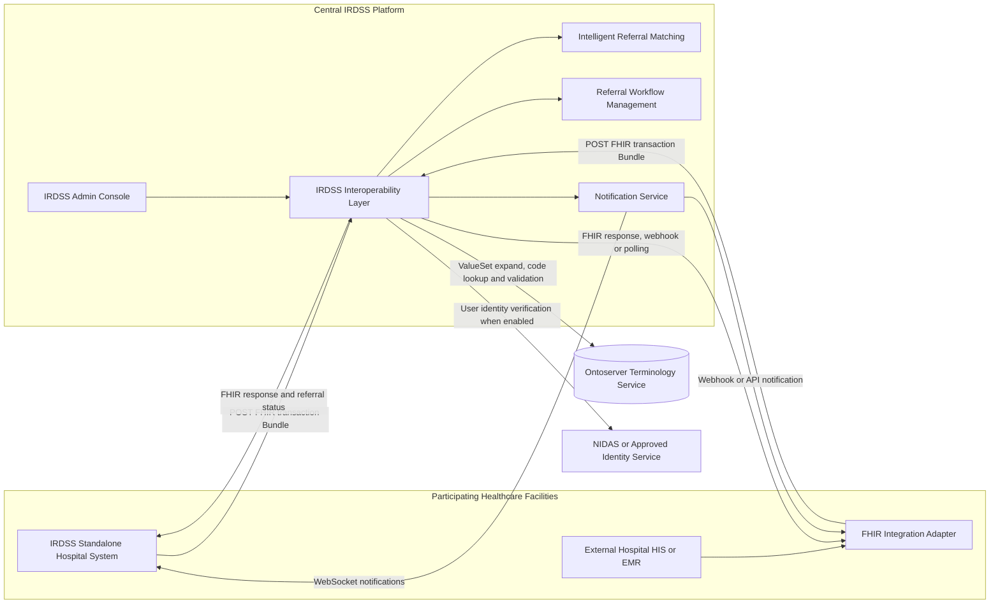
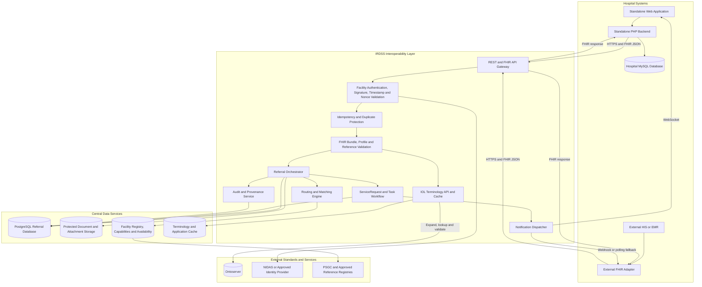
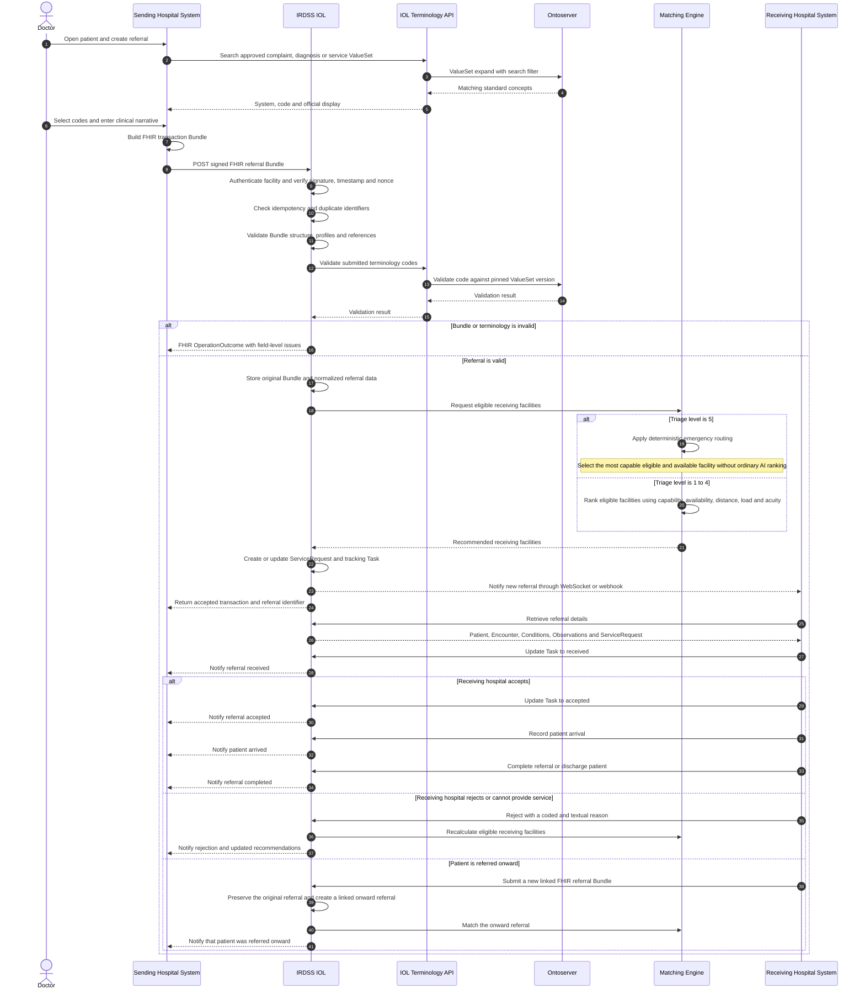
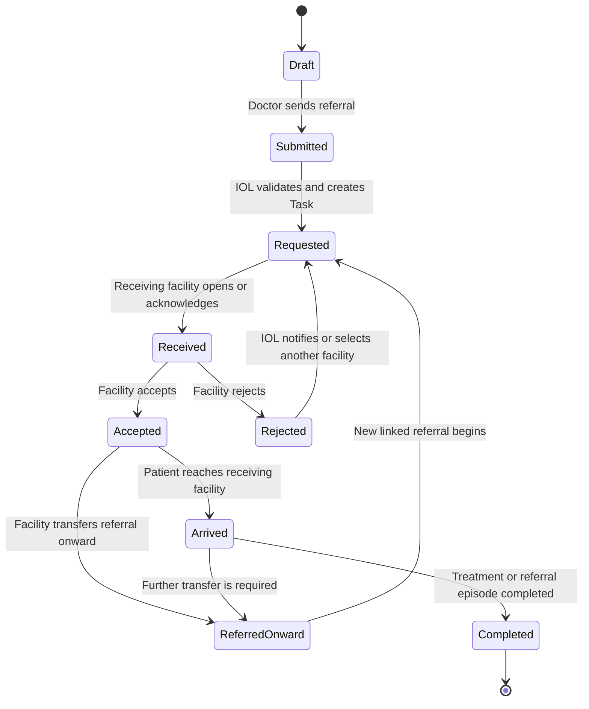

# IRDSS Target System Architecture

## Purpose

This document presents the intended completed architecture of IRDSS. A healthcare facility may use the IRDSS Standalone Hospital System or continue using its own HIS/EMR. Both communicate through the central IRDSS Interoperability Layer (IOL) using FHIR R4 JSON over secured REST APIs.

The IOL is the referral exchange and orchestration platform. Ontoserver is used only for terminology search and validation; patient referrals are never sent to Ontoserver.

## Rendered diagrams

| Diagram | Mermaid source | SVG | PNG |
| --- | --- | --- | --- |
| IRDSS eReferral Interoperability Architecture - recommended for the DOST technical report | [`irdss-system-architecture.mmd`](architecture/irdss-system-architecture.mmd) | [`irdss-ereferral-interoperability-architecture.svg`](architecture/irdss-ereferral-interoperability-architecture.svg) | [`irdss-ereferral-interoperability-architecture-final.png`](architecture/irdss-ereferral-interoperability-architecture-final.png) |
| System context | [`irdss-system-context.mmd`](architecture/irdss-system-context.mmd) | [`irdss-system-context.svg`](architecture/irdss-system-context.svg) | [`irdss-system-context.png`](architecture/irdss-system-context.png) |
| Detailed component architecture - technical appendix | [`irdss-component-architecture.mmd`](architecture/irdss-component-architecture.mmd) | [`irdss-component-architecture.svg`](architecture/irdss-component-architecture.svg) | [`irdss-component-architecture.png`](architecture/irdss-component-architecture.png) |
| Referral sequence | [`irdss-referral-sequence.mmd`](architecture/irdss-referral-sequence.mmd) | [`irdss-referral-sequence.svg`](architecture/irdss-referral-sequence.svg) | [`irdss-referral-sequence.png`](architecture/irdss-referral-sequence.png) |
| Referral workflow | [`irdss-referral-workflow.mmd`](architecture/irdss-referral-workflow.mmd) | [`irdss-referral-workflow.svg`](architecture/irdss-referral-workflow.svg) | [`irdss-referral-workflow.png`](architecture/irdss-referral-workflow.png) |

## 1. Simplified System Architecture

This is the recommended primary architecture diagram for the DOST technical report. It follows the referral from either type of hospital system through the IOL in six steps.



Mermaid source: [`architecture/irdss-system-architecture.mmd`](architecture/irdss-system-architecture.mmd)

### Simplified flow

1. Doctors use either the IRDSS standalone application or their hospital's existing HIS/EMR.
2. In the target architecture, both systems convert the required referral data into the same signed FHIR R4 transaction Bundle following PH Core and PH eReferral requirements. The external HIS adapter and full standards conversion are marked as planned.
3. The IOL authenticates the facility and validates the Bundle. Planned terminology integration calls Ontoserver to expand ValueSets and search, look up, or validate SNOMED CT, LOINC, and UCUM codes. Planned central PSGC validation checks Philippine geographic codes.
4. The IOL stores the referral and audit history in PostgreSQL, with documents placed in protected storage.
5. The matching service identifies the most appropriate eligible and available receiving hospital.
6. The target standardized workflow uses `ServiceRequest` and `Task`; the current custom referral workflow, WebSocket, and polling continue operating during migration. Notifications return status updates to participating hospital systems.

## 2. System Context



### Context rules

- Hospitals do not require direct system-to-system connections with every other hospital.
- Every participant connects to the central IOL using the same FHIR referral contract.
- An external hospital retains its existing HIS/EMR and adds a FHIR adapter.
- The standalone system includes its adapter in the Mock Hospital backend.
- Ontoserver receives terminology queries only, not patient demographics or complete referral Bundles.

## 3. Detailed Component Architecture



### Component responsibilities

| Component | Responsibility |
| --- | --- |
| Hospital adapter | Maps local records to and from the shared FHIR referral contract |
| API gateway | Exposes secured REST/FHIR endpoints and controls request access |
| Security service | Verifies the sending facility, signature, timestamp, nonce and user identity where required |
| FHIR validator | Validates transaction Bundles, profiles, identifiers and internal references |
| Terminology API | Searches and validates pinned ValueSets through Ontoserver and provides cached fallback results |
| Referral orchestrator | Stores the referral, connects its resources and coordinates downstream processing |
| Matching engine | Identifies eligible hospitals and ranks them according to capability, availability, location, load and acuity |
| Workflow service | Maintains `ServiceRequest`, `Task` and onward-referral state transitions |
| Notification service | Delivers WebSocket, webhook or polling-based status updates |
| Audit service | Records consent, provenance, status changes, reassessments and clinician overrides |
| PostgreSQL | Stores normalized central referral, FHIR identifier, workflow and audit data |
| Protected file storage | Stores consent forms and clinical attachments while PostgreSQL stores metadata and hashes |

## 4. End-to-End Referral Sequence



## 5. Referral Workflow States



## 6. Core Exchange Contract

The hospital systems exchange only the required referral information:

- Patient demographics and stable identifiers
- Encounter information
- Chief complaint and clinical narrative
- Working diagnosis
- Vital signs
- Referral category, service type and detailed reason
- Triage acuity, referral priority and condition severity
- Referring and receiving facilities and practitioners
- Consent metadata and approved attachments
- `ServiceRequest`, `Task` and `Provenance`

The transport contract is:

```text
Protocol: HTTPS
API style: REST with FHIR R4 resources
Payload: application/fhir+json
Submission: POST transaction Bundle to the IRDSS IOL
Terminology: SNOMED CT, LOINC, UCUM, PSGC and approved ValueSets
Workflow: ServiceRequest plus Task
Authentication: signed facility request, with NIDAS or another approved identity provider when enabled
```

## 7. Mermaid CLI regeneration

The committed diagram sources can be regenerated with Mermaid CLI from the repository root:

```powershell
npx -p @mermaid-js/mermaid-cli mmdc `
  -i docs/architecture/irdss-system-context.mmd `
  -o docs/architecture/irdss-system-context.svg `
  -c docs/architecture/mermaid-config.json `
  -b transparent
```

Replace the input and output names to render the component, sequence, or workflow diagram. Use `.png` as the output extension and `-b white -s 1.5` for a presentation-ready PNG.

## 8. Mermaid Live usage

Open `https://mermaid.live`, copy one Mermaid code block from this document, paste it into the editor, and export the result as SVG or PNG. SVG is recommended for reports and presentations because it remains clear when resized.
